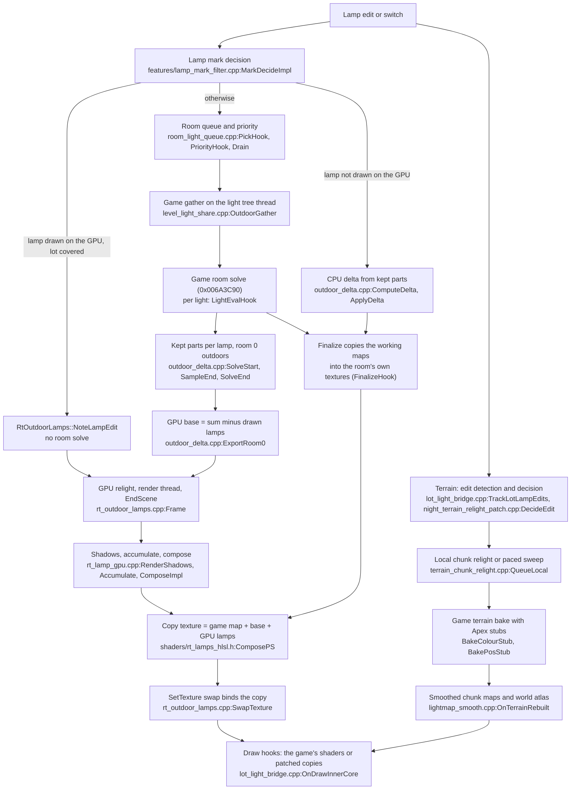

# Code map

This map leads from a question ("where is the lamp light on lot grass drawn?", "what does this setting change?") to
the exact file and function, and lists the rules a change must keep. It indexes the code; the feature pages explain
the behaviour. Read this page, then the one area page that matches the change, then the code it names.

- Every reference in backticks is checked against the code by `tools/code_map_check.py`: `file` (the file exists),
  `file:Name` (the identifier appears in it), `file@0x00ABCDEF` (the address appears in it). Search for the name;
  the map gives no line numbers because they change with every commit.
- Facts that the code does not confirm are marked UNVERIFIED.
- When the map and the code disagree, the code is correct: fix the map in the same change.
- Game addresses are for Steam 1.67.2 (image base 0x00400000), as in the rest of [docs](README.md).

## Areas

| Area page | Covers | Main files |
|---|---|---|
| [Framework, configuration and menu](code-map/framework.md) | Start-up, feature registry, D3D9 hook registry, game-code patching, game addresses, TOML settings, presets, menu, translations, log, crash report, loaded-world gate, shader cache, S3SS coexistence | `apex_main.cpp`, `framework/d3d9_hooks.cpp`, `framework/patch_base.cpp`, `framework/game_addresses.cpp`, `apex_config.cpp`, `apex_gui.cpp` |
| [Night Lighting: game side](code-map/night-game-side.md) | The Night Lights patch and its Present driver, terrain bake and relight, world atlas, lot light pass and ground shade, world lamp response, room light queue and lamp edits, every-story ground light; all `[patches.NightTerrainRelight]` settings | `patches/night_terrain_relight_patch.cpp`, `features/terrain_chunk_relight.cpp`, `features/lightmap_smooth.cpp`, `features/room_light_queue.cpp`, `features/lamp_mark_filter.cpp` |
| [Light between stories](code-map/level-light-share.md) | Light gather on every story, cross-story wall test, light through openings, stairwells, arches, directional maps, per-story caches | `features/level_light_share.cpp` and its policy headers |
| [Instant lamp lighting and kept parts](code-map/gpu-lamps.md) | Real-time outdoor lamps on the GPU, quick outdoor lamp edits (kept parts), the GPU lamp law | `features/rt_outdoor_lamps.cpp`, `features/rt_lamp_gpu.cpp`, `features/outdoor_delta.cpp`, `shaders/rt_lamps_hlsl.h` |
| [Night Lighting: draw side](code-map/night-draws.md) | Draw interception and classification, shader pattern patchers, walls, floors, roads, snow, roofs, water, objects and rigs, foliage, smooth room maps, Rooms at Night | `features/lot_light_bridge.cpp`, `features/shader_patches.cpp`, `features/object_light_bridge.cpp` |
| [Image effects](code-map/image-effects.md) | Post-scene chain and INTZ depth, Ambient Occlusion, Edge Smoothing, Depth Blur, Picture filters and LUTs, Banding Fix, Reflections | `features/post_scene.cpp`, `patches/ambient_occlusion_patch.cpp`, `features/picture.cpp`, `features/scene_dither.cpp` |
| [Performance, memory and developer tools](code-map/performance-and-tools.md) | The performance switches, file and resource caches, codecs and workers, memory, lot streaming, Frame Profiler, Light Probe (F7), Light Diag (F8), recorder and reports, developer mode | `patches/performance_patches.cpp`, `features/resource_cache.cpp`, `features/frame_profiler.cpp`, `features/light_probe.cpp`, `features/light_diag.cpp` |

## Night lighting in one picture

A lamp at night reaches the screen through two independent paths that start from the same edit: rooms (light maps
solved by the game, partly redrawn on the GPU) and terrain (the game's terrain bake, smoothed into the world atlas).
Draw hooks then read both.

The same flow as steps, with the reference behind each one:

1. **Mark.** The game's lamp entry update marks the lamp's room through `features/lamp_mark_filter.cpp:MarkDecideImpl`.
   With Instant, an outdoor lamp the GPU already draws (`features/rt_outdoor_lamps.cpp:HandlesLamp`) marks no room.
2. **Queue.** Marked rooms wait in the game's light tree queue; `features/room_light_queue.cpp:PickHook` and
   `features/room_light_queue.cpp:PriorityHook` order them (lamp edits and the played lot first) and
   `features/room_light_queue.cpp:Drain` solves extra rooms on the render thread within a time budget.
3. **Gather.** On the game's light tree thread, `features/level_light_share.cpp:OutdoorGather` adds lamps of other
   stories, openings, doors and windows to the game's own list (room+0xC8..+0xCC).
4. **Game solve.** The game solves the room's light maps (0x006A3C90, per point 0x0069FD60). Apex wraps each light's
   evaluation (`features/level_light_share.cpp:LightEvalHook`) for walls of other stories and openings.
5. **Kept parts.** For room 0 outdoors of the active lot, `features/outdoor_delta.cpp:SolveStart`,
   `features/outdoor_delta.cpp:SampleEnd` and `features/outdoor_delta.cpp:SolveEnd` record each lamp's contribution
   per texel (keyed by `features/outdoor_delta.cpp:KeyOf`). The GPU base is the sum minus the lamps the GPU draws
   (`features/outdoor_delta.cpp:ExportRoom0`).
6. **Finalize.** `features/level_light_share.cpp:FinalizeHook` wraps the game's finalize, which copies the working
   maps into the room's own textures, the ones the shaders sample.
7. **GPU relight** (Instant). In EndScene, `features/rt_outdoor_lamps.cpp:Frame` finds changed stories; per batch of
   lamps `features/rt_lamp_gpu.cpp:RenderShadows` and `features/rt_lamp_gpu.cpp:Accumulate` add the lamps into a float
   target, then `features/rt_lamp_gpu.cpp:ComposeImpl` writes a copy of the game's map with base plus GPU lamps. The
   game's texture is never written; `features/rt_outdoor_lamps.cpp:SwapTexture` binds the copy instead.
8. **CPU delta** (lamps the GPU does not draw). `features/outdoor_delta.cpp:ComputeDelta` replays only the changed
   lamps (`features/level_light_share.cpp:ReplayBatch`) and `features/outdoor_delta.cpp:ApplyDelta` writes
   `sum - old + new` into the locked working maps; the finalize then publishes them.
9. **Fallback.** Classic mode, a missing hook, an unsupported device, a refused delta or a full memory budget fall
   back to the game's full solve; `features/rt_outdoor_lamps.cpp:DropAll` unbinds every copy. The full table is on
   the [Instant lamp lighting](code-map/gpu-lamps.md) page.
10. **Terrain.** `features/lot_light_bridge.cpp:TrackLotLampEdits` counts lamp edits;
    `patches/night_terrain_relight_patch.cpp:DecideEdit` chooses a local relight
    (`features/terrain_chunk_relight.cpp:QueueLocal`) or a paced sweep. The game bakes the chunks through
    `patches/night_terrain_relight_patch.cpp:BakeColourStub` and `patches/night_terrain_relight_patch.cpp:BakePosStub`;
    `features/lightmap_smooth.cpp:OnTerrainRebuilt` refreshes the smoothed maps and the world atlas.
11. **Draw.** `features/lot_light_bridge.cpp:OnDrawInnerCore` classifies each draw and swaps in patched shaders that
    read the room maps, the world atlas and the GPU copies.

## Threads at a glance

Full tables: [architecture.md, section 10](architecture.md#10-threads-and-synchronisation).

| Thread | Apex code that runs there | Rule |
|---|---|---|
| Render (the game's main thread) | Every D3D9 hook, the post-scene chain, Night Lighting's Present driver (`NightTerrainRelight`, Priority::Last), the GPU lamp relight in EndScene, the menu | Game state and D3D resources are touched here only |
| Light tree gather (a game thread) | Gather, room solve, finalize and room update hooks of `features/level_light_share.cpp`; kept parts in `features/outdoor_delta.cpp` | Shares data with the render thread through mutexes, atomics or immutable copies; requests go through flags that the next Present handles |
| Simulation (Mono) | The game UI and scripts; Apex's script math and GC-related patches | No D3D work |
| Init / pump (Apex) | Start-up `Install()` of every feature, `Update()` every 10 ms, autosave | No game objects; no D3D calls |
| Apex workers | Log writer, shader precompile, light map smoothing, DXT / RefPack / CAS workers, fast memory release, developer samplers | No game objects; results are picked up on the render thread |

## Where to change X

Each area page has more rows. Lighting changes also need the part's feature page first
([Night Lighting](features/night-lighting/README.md)).

| To change | Start at |
|---|---|
| Start-up order, pump tasks | `apex_main.cpp:InitBody` |
| A new game address or byte check | `framework/game_addresses.h:Id`, `framework/game_addresses.cpp:kInfo`, `framework/game_addresses.cpp:kTable` |
| A new D3D9 device method in the registry | `framework/d3d9_hooks.cpp:Targets`, `framework/d3d9_hooks.cpp:UnregisterAll` |
| What a profile or preset carries | `apex_config.cpp:FeaturePart`, `apex_config.cpp:KeepProfileParts` |
| When effects and the menu start after a load | `features/world_session.h:InWorld`, `apex_gui.cpp:UpdateMenuAvailability` |
| Which draw a lighting fix sees, and in which order | `features/lot_light_bridge.cpp:OnDrawInnerCore`, `features/lot_light_bridge.cpp:Classify` |
| A surface's lamp term inside its patched shader | the patcher in `features/shader_patches.cpp` named on the [draw side](code-map/night-draws.md) page (for example `features/shader_patches.cpp:PatchBakedAtlasPs`) |
| Roof or water shading | `shaders/roof_ps.hlsl`, `shaders/water_lamps_ps.hlsl` and their `*_hlsl.h` copies; `features/lot_light_bridge.cpp:DrawRoof`, `features/lot_light_bridge.cpp:DrawLake` |
| Outdoor objects' per-pixel lamps | `features/lot_light_bridge.cpp:PickObjectLamps`, `features/lot_light_bridge.cpp:DrawObjectLamp` |
| Which lot lamps enter the terrain bake | `patches/night_terrain_relight_patch.cpp:BakeTest`, `features/terrain_bake_rule.h:LotLampType` |
| Dusk and daylight rebuild timing | `features/terrain_lighting_policy.h:Cycle`, `patches/night_terrain_relight_patch.cpp:OnPresent` |
| Local terrain relight against full rebuild | `patches/night_terrain_relight_patch.cpp:DecideEdit`, `patches/night_terrain_relight_patch.cpp:TryLocal` |
| Ground light smoothing | `features/lightmap_smooth.cpp:Process`, `shaders/lightmap_smooth_ps.hlsl` |
| Room solve priority and rooms per frame | `features/room_light_queue.cpp:Prioritise`, `features/room_light_queue.cpp:Drain` |
| Which lamp edits skip the room solve | `features/lamp_mark_filter.cpp:MarkDecideImpl`, `features/rt_outdoor_lamps.cpp:HandlesLamp` |
| Which outdoor lamps a story's room 0 takes | `features/level_light_share.cpp:ShareOutdoorLights`, `features/level_light_share.cpp:AfterChangedWalk` |
| Light of another story or through a stair opening | `features/level_light_share.cpp:CrossFloorShadow`, `features/level_light_share.cpp:ShareIndoorLights` |
| Light through doors, windows and arches | `features/level_light_share.cpp:BuildStoryGrid`, `features/level_light_share.cpp:GridPassImpl` |
| Which lamps the GPU draws | `features/rt_lamp_model.h:Drawn` (also used by `features/outdoor_delta.cpp:DrawnLight`) |
| The lamp law (falloff, cones, reach) | `features/gpu_lamp_law.h:Eval` and `shaders/rt_lamps_hlsl.h:Law`, kept equal |
| Packing of a relit texel | `shaders/rt_lamps_hlsl.h:ComposePS`, `features/outdoor_delta_model.h:PackInput`, `features/rt_lamp_model.h:Compose`, kept equal |
| Kept-parts memory budgets | `features/outdoor_delta.cpp:kMaxBytes`, `features/outdoor_delta.cpp:kMaxPinnedBytes` |
| Post-scene effect order | `features/post_scene.h:Order`, `framework/scene_target.cpp:kBoundaryOrder` |
| Ambient Occlusion look and quality | `patches/ambient_occlusion_patch.cpp:kShaderSource`, `patches/ambient_occlusion_patch.cpp:RunAo` |
| A Picture filter or setting | `features/picture.cpp:kShaderSource`, `features/picture.h:PictureParams` |
| A performance switch | `patches/performance_patches.cpp`, `patches/performance.h`, `apex_gui.cpp:PerformanceCard` |
| Resource lookup and file list caches | `features/resource_cache.cpp:Find`, `features/resource_cache.cpp:EmulateKeyList` |
| A section of the F8 snapshot | `features/light_diag.cpp:WriteDiag` |
| The F7 `mod:` line | `features/lot_light_bridge.cpp:DescribeDraw` |

## Rules that must not break

These apply to every change; area pages add their own.

- **Lighting never gets worse.** A performance or memory change must leave every lit surface as it was. Compare in
  game before and after (same lot, time and camera) and with Light Probe captures; when unsure, keep the lighting
  path and find the cost elsewhere.
- **Evidence before patches.** Game code is patched by pattern with the expected bytes checked first; a missing
  pattern makes the patch fail and leave the game alone ([architecture.md, section 4.5](architecture.md#45-game-code-patching-helpers)).
  Shader patches refuse a shader whose pattern is absent ([shader patch conventions](features/night-lighting/README.md#shader-patch-conventions)).
- **Game state and D3D resources only on the render thread** ([architecture.md, section 10.4](architecture.md#104-synchronisation-rules)).
  Work from other threads is queued and done at the next Present.
- **Install and Uninstall are idempotent** and undo every write; D3D hooks are registered in `Install` and removed by
  name in `Uninstall` ([architecture.md, section 14](architecture.md#14-how-to-add-a-new-feature)).
- **TOML table and key names never change** once released; defaults in docs match the code.
- **A draw hook returns Skip only after issuing the draw itself**, guarded by an own-call flag.
- **Rejected approaches stay rejected** without new evidence: each feature page lists them and links its history page.
- **Offline harnesses are read-only**, print to stdout and never write many files ([workflow.md](workflow.md#4-testing)).
- **English source text** for the menu, logs and file names, with every new string in the translation tables.

## Known fragile points

Places where a correct-looking change breaks something elsewhere. Area pages list more.

**The same game read in several places.** A changed offset must be fixed in every copy.

- The room light list (room+0xC8..+0xCC) is read raw in about twenty functions of `features/level_light_share.cpp`
  and in `features/outdoor_delta.cpp:ReadList`, `features/rt_outdoor_lamps.cpp:ReadList` (identical copies),
  `features/light_diag.cpp` and `features/unlit_rooms.cpp`. It is written by
  `features/level_light_share.cpp:DropDisabledLotLights` and swapped for one call by
  `features/level_light_share.cpp:ReplayCall`, on the light tree thread, while the render thread may read it
  (UNVERIFIED whether this race shows). Full list: [light between stories](code-map/level-light-share.md).
- The package list (manager+0x30/+0x34) is read in five places with different validation:
  `features/resource_cache.cpp:ReadList` (capped, refuses a null list), `features/resource_cache.cpp:ReadListRaw`
  (no cap; `features/resource_cache.cpp:EmulateKeyList` then walks it without SEH), `features/resource_cache.cpp:ListEntryIs`,
  `features/resource_cache.cpp:ListIs` and `features/frame_profiler.cpp:PackagesProbed`. Its fingerprint is computed
  twice (`features/resource_cache.cpp:BuildSnapshot`, `features/resource_cache.cpp:Fingerprint`).
- Room and story fields (room+0x18, +0xF4, manager+0x88, +0x90/+0x94) are read by `features/outdoor_delta.cpp:ReadRoom`,
  `features/rt_outdoor_lamps.cpp:ReadRoomNow`, `features/level_light_share.cpp:ReadMgrLotStory` and others; the tree
  level layout by `features/outdoor_delta.cpp:ReadTracker` and `features/rt_outdoor_lamps.cpp:TrackerOfTl`.
- Light fields are read by `patches/night_terrain_relight_patch.cpp:BakeTest` (inside the game's bake, without SEH),
  `features/lot_light_bridge.cpp:ReadLotLamp`, `features/rt_outdoor_lamps.cpp:ReadLamp` and
  `features/outdoor_delta.cpp:ReadLight`. The terrain bake rule exists in `features/terrain_bake_rule.h`,
  `features/level_light_share.cpp:InTerrainBake` and `features/rt_outdoor_lamps.cpp:InTerrainBake`.
- "Has this light changed?" is answered twice, differently: `features/outdoor_delta.cpp:ReadLight` (a hash of raw
  byte ranges) and `features/lamp_mark_filter.cpp:Signature`.
- The law constants are read by two `ReadConsts` with different fallbacks (`features/outdoor_delta.cpp:ReadConsts`,
  `features/rt_outdoor_lamps.cpp:ReadConsts`).
- The Steam build timestamp 0x52DEC247 is compared directly instead of through `GameAddr::IsFixed` in
  `framework/transition_watch.cpp`, `framework/transition_calls.cpp`, `features/address_space.cpp`,
  `features/lot_load_analysis.cpp` and `features/memory_guard.cpp`.
- World manager offsets +0x41 and +0x1B4 are read in `features/world_session.h`, `framework/transition_watch.cpp` and
  `features/terrain_chunk_relight.cpp`.

**Copies that must stay equal.**

- GPU and CPU forms of the same arithmetic: `shaders/rt_lamps_hlsl.h:Law` with `features/gpu_lamp_law.h:Eval`;
  `shaders/rt_lamps_hlsl.h:ComposePS` and `shaders/rt_lamps_hlsl.h:BlockPS` with `features/outdoor_delta_model.h`
  (checked bit for bit by `tools/rt_lamps_test/`).
- Each HLSL source and its embedded header are edited together, with no generator in the repository:
  `shaders/roof_ps.hlsl`, `shaders/roof_snow_lamps_ps.hlsl`, `shaders/water_lamps_ps.hlsl`,
  `shaders/lightmap_smooth_ps.hlsl`, `shaders/terrain_bake_ps.hlsl` and their `*_hlsl.h` files.
- The scene-end rule (depth test ALWAYS without depth write marks the UI) in `features/post_scene.cpp:OnGameDraw`,
  `features/picture.cpp:OnGameDraw` and `features/scene_dither.cpp:OnDraw`; the depth projection constant in
  `features/post_scene.cpp:CameraDepthA`, `patches/depth_blur_patch.cpp:kDepthA` and `features/lot_light_bridge.cpp:DrawLake`.
- "A chunk touches a rectangle plus 1 m" in `features/terrain_chunk_relight.cpp:kMargin`,
  `features/terrain_stamps.cpp:Touches` and `features/lightmap_smooth.cpp:ChunkTouches`.
- FNV-1a shader hashing in `shaders/shader_ids.h:ShaderHash` and inside `features/lot_light_bridge.cpp`; bytecode token
  helpers in `features/shader_patches.cpp` and `features/foliage_vertex_lamps.cpp`.
- Profile membership by feature name literal in `apex_config.cpp:FeaturePart`: a renamed feature silently leaves
  profiles.

**Tests that cut production code out by its text.** These harnesses find a function by its name or a nearby comment;
a rename or a moved comment makes them fail to compile or to find the slice. Update them in the same change.

| Source file | Harnesses |
|---|---|
| `features/level_light_share.cpp` | `tools/roofed_openings_test/`, `tools/room_gather_queue_test/`, `tools/room_structure_test/`, `tools/lighting_prepare_test/`, `tools/lighting_restart_test/`, `tools/exterior_lookup_test/`, `tools/terrain_lighting_test/` |
| `features/lot_light_bridge.cpp` | `tools/terrain_lighting_test/`, `tools/mesh_occlusion_test/` |
| `features/rt_outdoor_lamps.cpp` | `tools/lighting_restart_test/` |
| `patches/night_terrain_relight_patch.cpp` | `tools/terrain_lighting_test/`, `tools/lighting_restart_test/` |
| `apex_config.cpp`, `apex_gui.cpp`, `ui/widgets.cpp` | `tools/profile_package_test/`, `tools/report_check/`, `tools/developer_mode_check/`, `tools/public_test_notice_test/`, `tools/loading_gate_test/` |
| Image effects | `tools/post_scene_test/`, `tools/ao_receiver_test/`, `tools/spatial_aa_check/`, `tools/cube_lut_test/`, `tools/banding_fix_check/` |
| `features/script_math.cpp`, `features/object_index.cpp`, `features/scene_budget.cpp` | `tools/gameplay_stability_test/`, `tools/scene_budget_test/` |

**Threads and order.**

- `features/level_light_share.cpp:g_gatherThread` is rewritten by every gather; every light tree hook keys off it.
- Render-thread sends (`features/level_light_share.cpp:QueueRoom`) call game code on tree levels that the light tree
  thread changes, guarded only by SEH.
- Night Lighting's Present callback runs `patches/night_terrain_relight_patch.cpp:OnPresent` before
  `features/lot_light_bridge.cpp:OnPresent`, so lamp-edit counts reach the terrain decision one frame late.
- The default `framework/patch_base.cpp:Update` reinstalls a feature on the pump thread; a feature that frees D3D
  objects must override it.
- `patches/depth_blur_patch.cpp:DepthShare::Request` and `patches/depth_blur_patch.cpp:StopDepth` are unguarded and do
  D3D work on the caller's thread; `patches/edge_smoothing_patch.cpp:RunDepthPass` samples the INTZ depth while it is
  still bound.
- Names that point to more than one function: `features/level_light_share.cpp:WallPass` has two overloads, and
  `PumpLightingRestart` exists in both `features/level_light_share.cpp:PumpLightingRestart` and
  `patches/night_terrain_relight_patch.cpp:PumpLightingRestart`. Search with the file name.

**Stale text and unused code** (fix or remove when the area is next changed):

- The documented log line `[LotLightBridge] Shaders at their first draw` does not exist; the code logs one line per
  shader from `features/lot_light_bridge.cpp:PatchedFor`.
- `tools/temporal_check/` expects identifiers removed from `patches/edge_smoothing_patch.cpp`;
  `features/scene_dither.cpp:SceneBinder`, `features/shader_patches.cpp:AddJitterVs` and `features/temporal_sampling.h`
  have no production caller.
- `features/bloom_alpha_probe.cpp:Request` adds a post-scene effect that is never removed.
- The every-room GPU API (`features/rt_lamp_gpu.cpp:AccumulateRlg`, `features/rt_lamp_gpu.cpp:ComposeRlg`) is called
  only by `tools/rt_lamps_test/`.
- `features/lot_light_bridge.cpp:SetObjectPixelLamps` writes `g_objPixel` and `SetObjectPixelLights` writes
  `g_objPixelLamps`: the names are crossed.
- Comments in `features/rt_outdoor_lamps.cpp`, `features/rt_lamp_gpu.h` and `features/gpu_lamp_law.h` name files that do
  not exist; `features/light_probe.h` says BMP where the code writes PNG; `ApexLog::SetVerbose` has no caller.

## How to validate a change

1. **Build** (Release|Win32; command in [workflow.md, section 1](workflow.md#1-build)). A new `.cpp` file must be
   added to `ApexRadiance.vcxproj`. Build the public flavour too (`/p:ApexFlavorDefines=APEX_NO_DEV_TOOLS`) when the
   change touches developer-only code paths.
2. **Offline checks.** `tools/development/check.ps1` with `-Suite Smoke` and `-Suite Lighting` (what CI runs), then
   the harnesses that the area page lists for the changed files. Harnesses that extract a production function by
   its text fail loudly after a rename: update the harness in the same change.
3. **Public text and the map.** `python tools/public_text_check.py --files <changed files>` and
   `python tools/code_map_check.py`.
4. **Install** only with the game and launcher closed, after a backup ([workflow.md, section 2](workflow.md#2-install)).
5. **Read the log** (`ApexRadiance_LOG.txt`): every feature prints `Installed` or `Failed: <reason>` with its prefix;
   `[Addr]` lines show addresses and patterns found or missing; `[D3D]` lines show hook attaches. A changed patch
   must still log its install, with no new pattern or byte-check failure.
6. **Look in game** at the same lot, time of day and camera as before the change. For lighting, capture the wrong
   pixel with Light Probe (Ctrl+Shift+F7; the `mod:` line says which fix redrew the draw) and the light state with
   Light Diag (Ctrl+Shift+F8); for frame time, use the Frame Profiler. What each file section means is on the
   [developer tools](code-map/performance-and-tools.md) page.
7. **Record** the harness results and the in-game check in the feature's validation page.

## Keeping the map current

- A change that adds, renames or removes a file, an entry point, a hook, a setting or a harness updates the area page
  in the same change.
- `python tools/code_map_check.py` checks this page and every page in `docs/code-map/`; the public text workflow runs
  it on every pull request.
