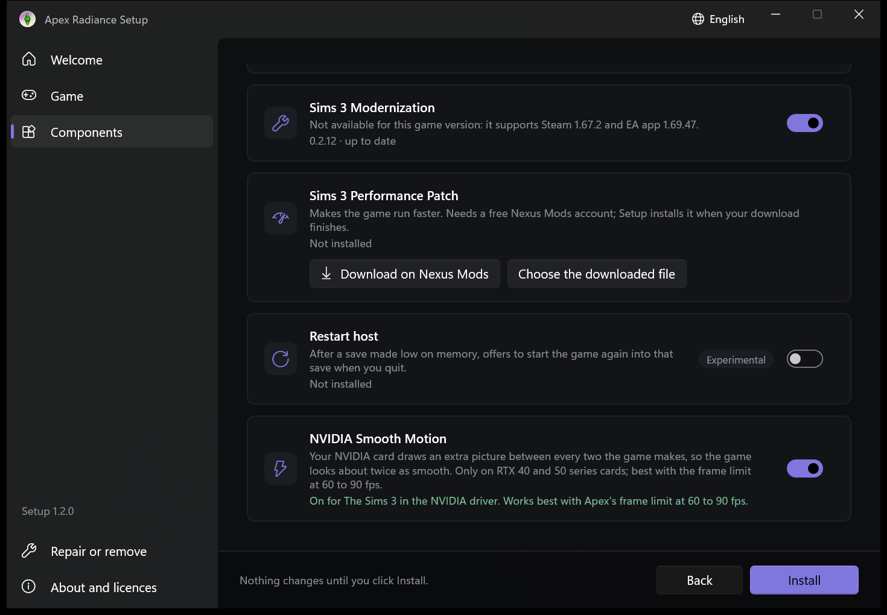
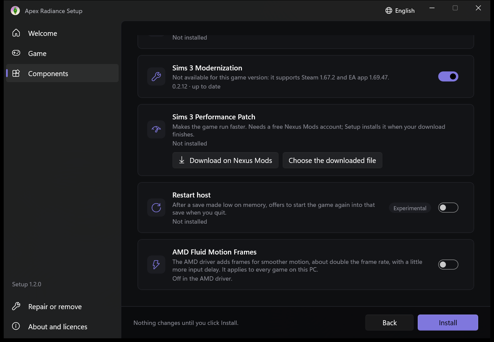
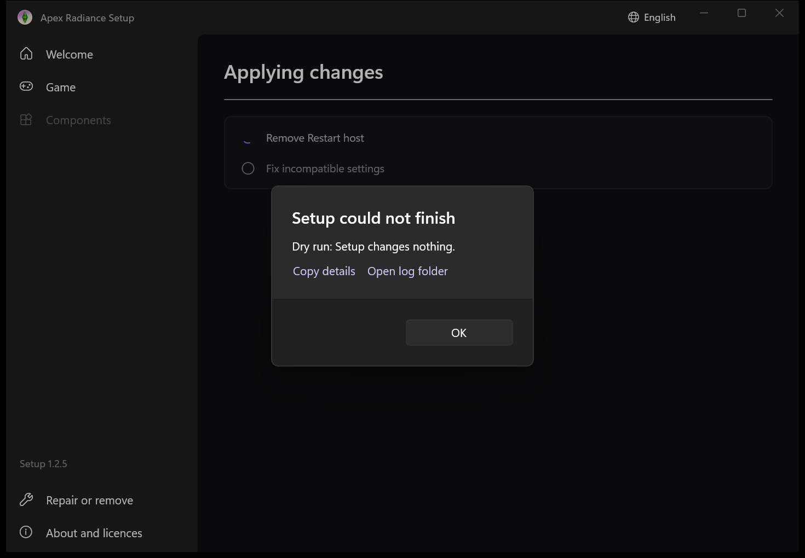

# Apex Launcher (Apex Radiance Setup)

A Windows program, `ApexLauncher.exe` (Apex Radiance Setup up to 1.2.x, `ApexRadianceSetup.exe`), that installs Apex
Radiance and the mods it works with into The Sims 3, keeps them up to date, checks the installation and repairs or
removes it. From 2.0.0 it is also the place the game is started from: Play, the game's health, the player's mods,
worlds, saves and pictures, and what is new. The player picks the game and the components;
Setup downloads each file from its author's own release and changes only what differs from that choice. Every change
Setup makes can be undone from a restore point. It is optional: the manual install in the
[README](../../README.md#installation) gives the same result.

## Status

| | |
|---|---|
| Availability | Released in 3.1.1; `ApexRadianceSetup.exe` is a release asset. Setup's own update: Released in 3.1.4 (Setup 1.1.0). Modernization from the newest release with the game's build, a moved EA app game: Released in 3.1.5 (Setup 1.1.1). Installs from the manual-install zip (the release's two files): Released in 3.1.6 (Setup 1.1.2). DXVK and the bridge offered only when the graphics driver has the extensions DXVK needs, MonoPatcher no longer offered (shown only where installed): Released in 3.2.1 (Setup 1.1.3). The restart host as an experimental component, off by default: Released in 4.0.0 (Setup 1.1.5). The RTX Remix bridge as the default renderer of a first install: Released in 4.0.1 (Setup 1.1.7). NVIDIA Smooth Motion switch: Released in 4.0.3 (Setup 1.2.0). Sims 3 Modernization's experimental channel: Unreleased. The restart host on by default in a new install, no longer experimental: Released in 4.1.0. Apex Launcher 2.0 (the launcher below): Released in 4.1.0. Apex Launcher 2.3 (Game settings, adding files, profiles, merges edited in one go, Saves cleaning and backups, Health by check): Released in 4.1.1 |
| Default | Optional, a separate download |
| Menu | None: a separate program, not part of the in-game menu |
| Configuration | `Game\Bin\Apex Radiance backup\setup.json` (written by Setup; also Sims 3 Modernization's channel, `ModernizationChannel`); restore points in `Game\Bin\Apex Radiance backup\restore`; the launcher's own files in `%LOCALAPPDATA%\Apex Launcher` (`settings.json`, `gallery.json`, `language.txt`, mod notes, picture thumbnails, `ApexLauncher.log`); the program in `%LOCALAPPDATA%\Programs\Apex Launcher` |
| Source | [`installer/`](../../installer/) ([installer/README.md](../../installer/README.md)) |

## The problem

A manual install needs several files from different projects placed in `Game\Bin`: the ASI loader, Apex Radiance, an
optional renderer (DXVK or the RTX Remix bridge, whose `bridge.conf` must name the game's exe) and the other mods a
player uses. Each has its own release page and its own update cycle, a wrong or duplicate file stops a mod from loading,
and a file overwritten by hand cannot be put back.

## How Apex Radiance solves it

Setup finds the game, compares what is installed with the player's choice and applies the difference:

1. **Game.** It finds Steam 1.67.2 (`TS3W.exe`) and EA app 1.69.47 (`TS3.exe`) installs, or a folder the player picks.
2. **Components.** Apex Radiance is required. The renderer is the RTX Remix bridge (recommended, chosen by default on a first install, DXVK when the GPU check rules it out; an update keeps the installed renderer) zip of the Apex
   release, DXVK, or the game's own Direct3D 9. DXVK and the bridge are offered only when a graphics card has Vulkan 1.3 and the
   device extensions DXVK requires (`Gpu.DxvkExtensions`, from DXVK 3.1.1's required list); without them DXVK finds no adapter
   and the game closes at start. Vulkan 1.3 with an extension missing is an old driver, not an old card (an Intel Iris Xe on
   driver 101.4502 lacks `VK_KHR_load_store_op_none`, which Iris Xe drivers have from 101.6556): Setup then asks for a driver
   update, and when DXVK or the bridge is already installed the status shows the error with the vendor's driver page; Ultimate ASI Loader is added only when no loader is found; other mods that work
   with Apex can be switched on. The [restart host](performance/restart-host.md) (*TS3Wrap* in the launcher) is a switch, on in a new install
   unless the player turns it off (off while Apex has not yet copied older S3SS settings): on installs `ts3wrap.exe` next to the ASI and sets `[ui] restart_host = true` in `ApexRadiance.toml`; off
   removes the exe and sets the key to `false` when it is there. Setup 1.1.4 and earlier copied `ts3wrap.exe` with Apex
   and left it off; an Apex update now removes that copy unless the host is on. The full list, with sources and target folders, is in
   [installer/README.md](../../installer/README.md#what-it-does).
3. **Install.** Every file is downloaded at install time from its author's GitHub release (never re-hosted) and checked
   against the release's SHA-256 digest when it has one. A file is copied only when it is missing or older than the
   latest release. Switching an installed component off removes it.
4. **Backups.** Every file Setup replaces is moved to `Game\Bin\Apex Radiance backup` with `.bak` appended, so no
   loader reads it. `setup.json` in that folder records what Setup installed.
5. **Compatibility fixes.** At the end of every install, or with *Fix settings* on the Components step, Setup runs the checks of the game's
   Settings > Compatibility page before the game starts and fixes what it can (a second ASI loader or Apex copy, a
   wrong `client.targetProcess`, a missing `Resource.cfg`); the rest is reported with a link.
6. **Suggestions.** What Apex Radiance recommends in game is listed as *Suggested for Apex Radiance* on the Components
   step and on the game's status, only while `ApexRadiance.asi` is installed: turning off the game's Edge Smoothing
   when it blocks Apex effects that are on, moving a renamed second copy of `ApexRadiance.asi` aside, and the renderer
   and Sims3SettingsSetter Apex recommends. None runs with Install or Repair: each has its own *Apply* (or *Apply all
   suggestions*), and a component suggestion points to Components. Applying one keeps the Components choices not yet
   installed. The full list is in [installer/README.md](../../installer/README.md#suggestions).
7. **Restore points.** Before every change (install, update, repair, removal, a fix or a suggestion) Setup opens a
   restore point: a copy of each file as it was before Setup first touched it, in `Game\Bin` and in Documents, and the
   files and folders it created. Every write of `ApexSetup.Core` goes through one function, so nothing is left out, and
   a file's read-only attribute is kept. An action that changes nothing keeps no point; the newest 5 are kept. The
   *Restore points* card on *Repair or remove* lists them; *Restore* puts the files back and undoes every newer point
   too. When a change fails, its error offers *Undo these changes*.
8. **Check installation.** On a game that has Apex Radiance, the welcome page shows what is installed and whether it is
   up to date, with *Update now* for the components that have a newer release. *Check installation* scans the game
   again and verifies the installed files and the compatibility checks.
   **Setup's own update:** when the latest Apex Radiance release has an `ApexRadianceSetup.exe` of a higher version
   (Apex Radiance Setup, checked against GitHub's SHA-256 digest), the welcome page shows *A new Setup is available*
   with *Update Setup*: the running exe is renamed to `.old` (deleted at the next start), the new one takes its place
   and opens. Setups before 1.1.0 (Apex Radiance 3.1.3 and earlier) do not look for it.
9. **Repair or remove.** *Repair* downloads and copies again everything installed. Each component can be removed on its
   own, putting back the files it replaced. *Uninstall everything* removes Apex Radiance and what Setup installed and
   restores every replaced file; mods installed by hand and the settings in Documents stay.

**NVIDIA Smooth Motion** (Setup 1.2.0) is the last row of the Components step: frame generation in the NVIDIA driver, about
double the frame rate on RTX 40 and 50 series cards, with a little more input delay. The NVIDIA app reports the RTX Remix
bridge as not compatible; a driver profile forces it, the way NVIDIA Profile Inspector does
([rtx-remix-bridge.md](rtx-remix-bridge.md)). The switch applies at once, outside Install, through NVAPI's driver settings
(`SmoothMotion.cs`). NVIDIA ships its own profile *NvRemixBridge* holding `NvRemixBridge.exe` with Smooth Motion - Enabled
APIs (`0xB0CC0875`) at 0, which blocks it; Setup edits the profile that holds the bridge's exe, as Profile Inspector does:
on sets `0xB0D384C0` (Smooth Motion) to 1 and `0xB0CC0875` to 7 (DX12, DX11 and Vulkan). When no profile holds the exe, Setup
creates *Apex Radiance - The Sims 3* with it. Off restores NVIDIA's defaults of both settings (or deletes Setup's profile),
only when Setup turned it on, recorded in `%ProgramData%\Apex Radiance Setup\smooth-motion-on.txt`: a Smooth Motion the
player turned on with Profile Inspector shows as on and stays. The game's exes stay in NVIDIA's own *Sims 3* profile: they
do not present frames under the bridge. The profile matches exe names, so it covers every copy of the game on the PC, Steam
or EA app. The row shows only with an NVIDIA card. It can be turned on with an RTX 40 or 50 series card, driver 571.86 or
newer, and the RTX Remix bridge chosen (installed, or going in with the same Apply or first install, which make the driver
change after the files); otherwise it stays off and says why, and the first install leaves the row out. When the bridge's exe belongs to a profile
of the player's, Setup leaves it alone and names that profile. The profile is not part of restore points (it is a driver setting, not a game file). Turned on, Setup also brings
Apex's frame limit (`[screen] fps_limit` in the game's `ApexRadiance.toml`) to 60 fps when there is none (the key absent or
0); a limit the player chose stays as it is, and the row suggests 60 to 90 fps. That change has its own restore point
(*Turn on NVIDIA Smooth Motion*) that puts back only `fps_limit`; nothing is written before the game has made the file or
while it runs. Turning Smooth Motion off leaves the frame limit as it is.

How it follows the other actions:

| Action | Smooth Motion |
|---|---|
| Removing the RTX Remix bridge, switching from the bridge to DXVK or the game's own Direct3D 9, removing Apex Radiance, *Uninstall everything* | Turned off (Setup's profile deleted) as part of the action, with its own task row on the Install step; an NVAPI failure is logged and shown on the row and never fails the action |
| Repair, Setup's own update, a later run | Left as it is; the row reads the driver again (no record kept) |
| A profile deleted by the player, a driver reinstall | Reads as off |
| A profile of the player's holding an exe | Never touched by any of the above |
| Dry run, preview | Nothing written |

| Off (no bridge on this game) | On | Unsupported card |
|---|---|---|
|  |  |  |

**Apex frame limit** sits below the frame generation rows while either can be used and the game has made
`ApexRadiance.toml`: a list with *Keep* (the value now), Apex's own choices (off, 30, 60, 120, 144, 165, 240) plus 75 and 90,
the 60 to 90 ones marked recommended, and *Custom* (20 to 1000, clamped as Apex reads it). A choice writes
`[screen] fps_limit` at once, through a temporary file, in its own restore point (*Apex frame limit*) that puts back the
value before only while the file still holds the one Setup wrote; the game must be closed, and the dry run writes nothing.

The Smooth Motion and AFMF switches and the frame limit list write nothing when clicked (Setup 1.2.3): each is a pending
change, as a component is. The row says *Turns on when you click Apply* (or off, or *Changes to 75 fps*), the footer button
counts it (*Apply 1 change*) and its note lists it (*To apply: Turn on NVIDIA Smooth Motion*); switching back to the state now
drops it. Apply runs them as task rows after the components (*Apex frame limit: 75 fps*, *Turn on NVIDIA Smooth Motion*,
*Turn off AMD Fluid Motion Frames*); a failure marks its row and shows on the component row, and the rest goes on. After a
driver write Setup reads the setting back in a new session; a change the driver did not keep is reported, and an *on* that did
not take is undone. Errors read in plain words (the call and its code go to `%LOCALAPPDATA%\Apex Radiance Setup\ApexRadianceSetup.log`): missing rights
ask for administrator rights, and a rejected change points to the manual steps (*How to do it by hand*: the README's Profile
Inspector steps; for AFMF, AMD Software > Gaming > Graphics > AMD Fluid Motion Frames).

| Case | Behaviour | Checked |
|---|---|---|
| RTX 4070 Ti SUPER, driver 621.24 | Reads card, driver, NVIDIA's *NvRemixBridge* profile | On the real driver (read only) |
| A driver without the *NvRemixBridge* profile | Setup's own profile with `NvRemixBridge.exe` | Tests |
| A driver without Profile Inspector's interface IDs | The public NVAPI IDs | Code path, not run |
| RTX 40 or 50 *Laptop GPU*; several NVIDIA GPUs | The RTX 40 or 50 one is judged, whatever the order (NVAPI lists no integrated GPU) | Tests |
| An AMD integrated GPU next to an NVIDIA card | AFMF row hidden unless ADLX reports it supported | Tests; ADLX read on a real integrated GPU |
| The driver does not keep the change | *Did not take*, an *on* undone, manual steps offered | Tests |
| No rights (`-137`, access denied) | *Run Setup as administrator* (Setup already asks for them) | Tests |
| Driver write on RTX 40 or 50; AFMF on RX 6000 or newer | | Unverified |

Only the frame generation row that applies shows (`Engine.FrameGenRows`): a usable NVIDIA card shows Smooth Motion; AFMF
shows where ADLX reports it supported, so an AMD integrated GPU that cannot run it shows nothing; with neither usable, the
NVIDIA row explains why when an NVIDIA card is there, else the AMD row does. The frame limit row names the frame generation
shown above it and, while frame generation is on or turning on, shows in the accent colour what the player gets: "60 fps
→ about 120 fps on screen with NVIDIA Smooth Motion", or about double with no limit; with it off, the limit as it is. A
limit the player chose in the same Apply (Off included) is kept; the automatic 60 fps is not applied for AFMF on a PC
with an NVIDIA card (the game may run on that card). Failed driver or frame limit changes are listed on the Done screen
(*Some changes did not apply*).

**AMD Fluid Motion Frames** (Setup 1.2.0) is the row after it, for AMD cards: frame generation in the AMD driver, through
AMD's ADLX (`Afmf.cs`). ADLX has AFMF as one setting for the whole system, not per game, so the row says it applies to
every game on the PC. The row shows when the AMD driver answers, and can be turned on where ADLX reports AFMF supported
(AMD documents Radeon RX 6000 series or newer); it does not need the RTX Remix bridge. On also applies the frame limit rule
above. Setup records that it turned AFMF on; removing the bridge or Apex (alone, by a renderer change or with *Uninstall
everything*) turns it off only then, never a setting the player had on. Dry run, preview and the fake write nothing.

| Off | On | Unsupported |
|---|---|---|
|  |  |  |

Both editions are covered: Steam 1.67.2 (`TS3W.exe`) and EA app 1.69.47 and 1.69.43 (`TS3.exe`). Smooth Motion's profile
holds the game's own exe, the bridge check reads `client.targetProcess = TS3.exe` on the EA app, and the frame limit goes to
the edition's Documents folder; AFMF needs nothing per edition.

When the renderer changes the graphics card the game sees, the game resets its graphics options once: Setup says so
and keeps a copy of `Options.ini`, restored when the player goes back to the game's own Direct3D 9.

## The launcher (2.0.0)

Apex Launcher keeps everything above as its *Components* screen and adds the screens a player uses every day. On
*Components*, Apex Radiance sits on its own card on top with its version and whether it is up to date. Under it,
*Parts of Apex* (Sims 3 Modernization, Graphics, frame generation and the frame limit, *TS3Wrap*) and the mods by other
modders (Sims3SettingsSetter, the Sims 3 Performance Patch, MonoPatcher) are rows of one height: icon, name and one
line, the state in a column of its own, and the controls on the right; a first install shows the same rows, the other
mods included, without the state column. Modernization's channel, the renderer (the RTX Remix bridge first, DXVK
or the Windows default) and the frame limit are menus in their rows; a choice the card or driver
blocks says why. A row that Apply changes carries a dot, and the footer lists those changes. It runs
as the signed-in user, not as administrator: a change to the game folder or to a driver setting is written as a plan
(`%LOCALAPPDATA%\Apex Launcher\ops`) and applied by the same exe started once with administrator rights
(`Elevation.cs`), one prompt per change. A game folder the user can write to needs no prompt.

- **Install and uninstall.** The first run copies the exe to `%LOCALAPPDATA%\Programs\Apex Launcher`, adds Start menu
  and desktop shortcuts and an *Installed apps* entry. *Uninstall* there (or in Settings) removes what the launcher
  installed in every game it knows and its own files; saves, mods put in by hand and `Resource.cfg`
  stay. A removal that fails half way leaves `setup.json` true to what is still installed, so a retry never deletes an
  original already put back; when turning frame generation off fails, its markers stay so a later uninstall can try
  again. Only the game-folder part runs as administrator; the Documents part (switched-off mods back on, Apex Radiance's
  settings unless kept) runs as the player. Files of the player's that a fix set aside in the backup folder go to the
  Recycle Bin. A launcher still open (in the tray too) closes first, and the launcher's exe and folder are deleted
  once it has closed. Settings from
  Apex Radiance Setup's data folder move to the launcher's on first start.
- **First install and updates as one card.** With no Apex Radiance in the game, the welcome and every step after it
  (game, components, installing, done) are one card in the middle of the window, without the sidebar; the components
  step is a short list of what goes in with Apex Radiance. Play with updates first lists them (*Update and play*, *Play
  without updating*); they run in the same card (*Updating*) and the game starts from Home. A failed first install or
  update is taken back out at once and one card says why (*Try again*, *Play anyway* for an update, *Copy details*). A game that is running, no internet or a protected game folder are said in the card. A new
  Apex Launcher is offered as its own card (*Restart now* or *Later*).
- **Installed or portable.** A copy that is neither (a download, or an Apex Radiance Setup that updated itself into
  the launcher) asks once: at start when the game already has Apex Radiance (after Setup, as *Apex Radiance Setup is
  now Apex Launcher*), on the done screen of a first install otherwise.
  A downloaded copy newer than the installed one replaces it and takes over: an older copy running closes (unless it
  is in the middle of a change) and the new one opens in its place; an older or equal download only opens the
  installed copy.
- **Home and Play.** The main button starts the game's exe directly (`TS3W.exe` or `TS3.exe`) at its main menu. The newest
  saves stand in one row, each with its own Play button, which starts the game straight into that save with EA's
  `-worldFile` switch (`Launch.cs`), over the picture chosen in Settings (a gallery picture, the household's photo, or
  none). With *Install updates when I press Play* on, the ready updates go in first (*Play without updating* skips
  them). Under the top, one line holds the game's health (its crystal, the state, the first thing to look at) and the
  last session (how long and how it ended); after a crash or low memory it offers *Start again into this save*. While
  the game runs, the top shows the playing time and the memory the game uses. When Apex Radiance cannot load, a banner
  says so and Play becomes *Play anyway*. *Hide while playing* sends the launcher to the notification area until the
  game closes.
- **Game settings.** Options the game keeps in `Game\Bin\GraphicsRules.sgr` (shadow and Sim texture size, bloom),
  `Game\Bin\Sims3.ini` (reads in flight, walking values) and `Options.ini` (shopping mode, memories, online features).
  Only a value the player changes is written, every other byte stays, and each file is copied before its first change;
  *Restore my files* and the uninstall put them back. A graphics card the game does not know can be added to its list.
  A first install offers the same options before it starts (`GameSettings.cs`).
- **Health.** A crystal in the state's colour and one tile per check, each with its own page, with automatic fixes,
  restore points and the last session. Every notice can be ignored and brought back. The state is *Blocked* only when
  Apex Radiance itself cannot load (`Health.StopsApex`: an error nothing fixes in Apex Radiance or the ASI loader);
  other unfixable errors need the player but leave Apex running. Suggestions, such as clearing the game caches or
  backing up a save, have their own button. The crash pattern reads the crash logs of the last week. A check that fails
  keeps the last findings rather than reading as passed. *Fix safe things without asking* applies the fixes that keep a
  copy of each file.
- **Mods.** Every package and script mod with its kind, folder, size and an on/off switch (off moves it to
  `Mods\Disabled (Apex Launcher)`), as a list sorted by its columns or a grid, with tags, notes, a page address, a
  picture, a search over folders and tags, filters, and the mod checks contributed through `ModChecks.cs`
  (`IModCheck`). Files the launcher installed are locked. *Default replacements* are the mods that replace an object, a
  Create a Sim part or a texture (`Replacements.IsDefault`); a mod that only overrides the game's tuning or scripts is
  not one. A mod's details hold its content (items and resources), the mods that share its game data, what it replaces
  and its notes.
  - **Add** takes packages, Sims, lots, households, worlds, archives and folders, each to the place the game reads it from
    (`ModAdd.cs`): the files are checked, compared with what is installed, copied under a temporary name and renamed into
    place, never over a file. A package that looks damaged shows unticked with the reason and is added when ticked;
    a damaged world is refused.
  - **Profiles** keep which mods are on; switching changes every mod or none, with Undo, and follows moves, renames and
    merges.
  - **Merge** writes several packages as one (`ModMerge.cs`). Mods that change the same game data in different ways stay out
    until the player puts them in and orders them. Every stored byte is copied as it is, the new file is read back by its
    SHA-256, then the originals move to `Merged (Apex Launcher)` next to Mods. A merge can be changed in one go (mods out,
    in, replaced, reordered, renamed), updated when a newer version of a mod inside is found, and split back. Every step
    that moves files can be undone, also after the launcher ends midway.
  - **Tools** finds custom content (what a Sim, lot or save needs), finds the mod behind a problem by halves, clears the
    game's caches by group and opens the game's folders.
  - **Conflicts** compares what the game would read: tuning without comments, layout and attribute order, text tables by
    id, settings files by their values, window layouts without their size. Identical copies are no conflict. Health shows
    each conflict with its level, and a mod can be given priority where `Resource.cfg` allows it.
- **Saves.** The saves on one side, with the ones gone from the game and the ones kept out of it, and the chosen one on
  the other: its backups and what can be cleaned (`SaveClean.cs`: the plan is exact to the byte, a checked zip is made
  first, the save is rewritten and read back, and the clean can be undone). *Clean several* cleans more than one at once;
  the pictures that stay are a dialog; rename, duplicate, keep out of the game and delete are in the save's menu.
  - **Backups** (`SaveCopies.cs`, `SaveBackups.cs`) are zips of the save's folder. Each can be restored over the save
    (which becomes one more backup, with Undo) or opened as another save, named, pinned, checked against its checksums,
    exported and moved to the Recycle Bin. A save that is gone, or kept out of the game, can be deleted with what is left
    of it. A name and a pin are kept in the zip's own comment; the list of mods that were
    on is a file inside (`apex-mods.txt`), used to tell which are missing on a restore and never written into the save.
  - **Automatic backups** (off until chosen) are made when the game closes, before Play or once a day, only of saves that changed and never
    while the game runs. Older automatic ones leave past the number to keep and past the space limit; ones the player
    made, named or pinned, and a save's newest one, never do. Each save can have its own choice. *All backups* lists them
    with filters and actions for a selection.
  - The backups can be kept in another folder: they are copied and compared there before they leave the old one.
    *Import* takes a zip with one save in it.
- **Gallery.** The pictures and videos Apex Radiance and the game save, from the folders `ApexRadiance.toml` names
  (`[ui] screenshot_folder`, `[capture.video] folder`: the game's, Apex's own or a chosen one), all of them at once so
  changing the setting hides nothing. *Albums* lists them by day or by household (the save written soonest after a
  picture), with favourites, captions, a search and the player's own albums; *Scrapbook* lays them on a timeline
  board with frames, tape, notes, stickers and albums as piles that open in place; an album opened from its pile keeps
  its picture sizes and rows and scrolls sideways in a narrow window. The viewer zooms, plays a
  slideshow, plays videos and moves a picture to the Recycle Bin. Changes can be undone with Ctrl+Z and redone with
  Ctrl+Y; on the scrapbook, undo takes back board changes only and keeps the view and the open album. *Use on Home*
  makes a picture the one on top of Home.
- **What's new.** The release notes of each component, read from its GitHub releases.
- **Look.** Light or dark and the accent colour follow Windows, also while the launcher is open. The window background
  is a setting (Mica, a stronger Mica, Acrylic or a solid colour).

## Settings

| Menu label | TOML key | Type | Default | Range | Effect |
|---|---|---|---|---|---|
| Language (title bar button) | None (`language.txt`) | choice | Windows' display language | The 21 languages of The Sims 3, as the in-game menu | The launcher's language; a text without a translation shows in English |
| Start with Windows | None (Windows' *Run* key) | switch | Off | | Opens quietly in the notification area at sign-in |
| Hide while playing | None (`settings.json` `HideWhilePlaying`) | switch | On | | The launcher goes to the notification area while the game runs |
| Fix safe things without asking | None (`settings.json` `FixSafeAutomatically`) | switch | On | | Health applies the fixes that keep a copy of each file |
| Install updates when I press Play | None (`settings.json` `InstallUpdatesOnPlay`) | switch | On | | The ready updates go in before the game starts; off, Play starts the game as it is |
| When the game closes (Saves, Automatic backups) | None (`backups.json` `OnClose`) | switch | Off | | A backup of each save played lately that changed since its newest one |
| Before playing | None (`backups.json` `BeforePlay`) | switch | Off | | The same before the game starts; *Play without waiting* skips it |
| Once a day | None (`backups.json` `Daily`) | switch | Off | | The same once a day, while the launcher is open and the game is closed |
| Backups of each save | None (`backups.json` `Keep`) | choice | 5 | 1, 3, 5, 10, 20 | How many automatic backups of a save stay |
| Space limit | None (`backups.json` `LimitGb`) | choice | 10 GB | 2, 5, 10, 20, 50 GB, No limit | Past it the oldest backups the launcher made by itself leave |
| Folder | None (`backups.json` `Folders`) | folder | `Saves backups (Apex Launcher)` in the game's Documents folder | | Where the backups are |
| Check each backup | None (`backups.json` `Check`) | switch | On | | Compares the zip with the save after copying; a backup before a clean or a restore is always compared |
| Remember the mods that are on | None (`backups.json` `RememberMods`) | switch | On | | Keeps the list of mods in the backup |
| Picture on top (Home) | None (`settings.json` `HomePicture`) | choice | A picture from the gallery | A picture from the gallery, The household's photo, No picture | What shows behind the save on top of Home |
| Gallery picture (Home) | None (`gallery.json` `HomePicture`) | buttons | The newest picture | *Choose in the gallery*, *Use the newest* | The gallery picture on Home: the one marked *Use on Home* in the Gallery, else the newest |
| Picture height (Home) | None (`settings.json` `HomePictureHeight`) | choice | Medium (330 px) | Low (240 px), Medium, Tall (440 px) | How much of the page the gallery picture takes |
| Picture strength (Home) | None (`settings.json` `HomePictureStrength`) | slider | 100% | 30 to 100%, step 5 | How strongly the gallery picture shows behind the save's name |
| Window background (Window) | None (`settings.json` `Backdrop`) | choice | Mica (Windows default) | Mica (Windows default), Mica, stronger, Acrylic, Solid colour | Mica and Acrylic take a tint from the desktop wallpaper; Solid colour takes none |

## Compatibility and interactions

- Setup refuses to change files while `TS3W.exe`, `TS3.exe`, the launcher (`Sims3Launcher.exe`, `Sims3LauncherW.exe`) or the restart host (`ts3wrap.exe`) runs.
- Sims 3 Modernization has a channel under its switch: *Stable* (default) or *Experimental*, test builds published as
  GitHub prereleases tagged `vX.Y.Z-exp.YYYYMMDD`. Experimental takes the newest of them with the game's build
  (`Engine.PickModernization`) and falls back to stable when there is none (the EA app for now); the log names the
  release and channel. The choice is kept in `setup.json`. An update within a channel keeps `ts3native.ini`; a channel
  change copies it to `ts3native.ini.<left channel>.bak` (`stable` or `experimental`, the last one kept) next to itself
  and writes the channel's own, since the switches differ between channels. When the release listing fails, the
  experimental channel shows no update and no channel change. Same-day builds (`-exp.YYYYMMDD.N`) count as newer by
  `N`. The status row shows the installed tag, with *Experimental* when it is one.
- It needs administrator rights (`Game\Bin` is usually under Program Files) and an internet connection to download.
- Mods published outside GitHub are recognised and listed with a link to their official page, never downloaded. The
  Sims 3 Performance Patch is on Nexus Mods only: Setup opens its page and installs the file when the download
  finishes.
- Apex Radiance itself does not depend on Setup; a manual install and a Setup install are the same files.

Before any download Setup checks what would stop the change (the game, its launcher or the restart host running, a
`Game\Bin` it cannot write to, too little free space) and tells what it will do to the player's own files (a foreign
`d3d9.dll` such as ReShade, named and set aside in the backup; a second ASI loader). A failed install puts back what it
changed unless the player keeps it. Errors read in plain words with the raw text below, *Copy details* and *Open log
folder*; the log is in the player's `%LOCALAPPDATA%\Apex Radiance Setup\`. The full list is in
[installer/README.md](../../installer/README.md#reliability-setup-124).

## Limitations

- Windows 10 version 1809 or later, 64-bit.
- A backup made or restored by 2.3, a cleaned save, a merged package written by 2.3 and the Game settings values are not yet verified in game.
- Not yet verified on a real install: the upgrade from Apex Radiance Setup 1.2.x, a full uninstall,
  the administrator window on a game under Program Files, Play and the session with the EA app edition, the tray.
  A save opened from Home, the crash state on Home, and the Acrylic and stronger Mica backgrounds are unverified.
- The texts added in 4.1.0 and 4.1.1 show in English outside Portuguese until they are translated.
- The game's own `Video.avi` recordings show without a picture when Windows has no decoder for them; they play when
  Windows can.
- Ultimate ASI Loader 10 (the latest release, which Setup installs) can open a *Select Override (Update) Folder* dialog at
  start: one player on the EA app saw it, with an empty button, before the launcher opened; 9.7.4 has no such dialog. What
  triggers it is unverified, so Setup does not change anything for it yet.
- Without the GitHub API (60 calls an hour per address) Setup reads the release pages instead.
- Restore points cover the files Setup changes; files changed by hand are not tracked. Restoring is final, needs the
  game closed, and only the newest 5 points are kept.
- The Edge Smoothing suggestion reads `Options.ini` `edgesmoothing`, where Apex reads the back buffer: 0 was seen with
  no MSAA, and that every other value means MSAA is unverified in game. It changes the file only when the player clicks
  *Apply*.
- AMD Fluid Motion Frames: unverified on a supported card (no RX 6000 or newer was available); the ADLX start and the
  supported check were read on an AMD integrated GPU, which reports it unsupported. Whether AFMF reaches frames presented by
  `NvRemixBridge.exe` (Vulkan) is unverified. The record that Setup turned it on is per Windows user, not per game folder.
- NVIDIA Smooth Motion edits NVIDIA's own *NvRemixBridge* profile and restores its defaults on off. Setup 1.2.0 wrote a
  profile of its own, which held no exe (both were in NVIDIA's profiles), so the write failed with `DRS_SetSetting -160`.
  The write on NVIDIA's profile is unverified until tested on an RTX 40 card. `0xB0D384C0` is not in the driver's list of
  named settings (621.24); Profile Inspector writes it all the same. Only a value set in the bridge's own profile counts as
  on (one inherited from the global profile does not reach the bridge, whose Enabled APIs still block it). The *How to do
  it by hand* link opens the README on GitHub's default branch, which has the Profile Inspector steps once release 4.0.3
  is merged. DXVK on `TS3W.exe` is Vulkan as well, but Smooth Motion under DXVK is untested, so the
  switch needs the bridge.

## Technical reference

- WinUI 3 on .NET 8, published as one self-contained x64 exe (`PublishSingleFile`, no MSIX, no runtime to install;
  [ApexSetup.csproj](../../installer/ApexSetup/ApexSetup.csproj)). The engine and the compatibility checks are in
  [ApexSetup.Core](../../installer/ApexSetup.Core/) (`Engine.cs`, `Compat.cs`); restore points in `RestorePoints.cs`
  (`Fs` is the one place that writes).
- Each language is a `Strings.<code>.cs` table with the English text as key; `ApexSetup.Tests` checks every table.
- Errors are logged to `%LOCALAPPDATA%\Apex Launcher\ApexLauncher.log` (Setup 1.2.x: `%LOCALAPPDATA%\Apex Radiance Setup\ApexRadianceSetup.log`).
  `APEX_LAUNCHER_LANG`, `APEX_LAUNCHER_THEME` (`light` or `dark`), `APEX_LAUNCHER_LOCALAPPDATA` and `APEX_SETUP_DOCUMENTS`
  point a test run at a language, a theme and fake data and Documents folders. `APEX_SETUP_DRY_RUN=1` shows what Setup finds and would change
  while writing nothing.
- Build and tests: [installer/README.md](../../installer/README.md#build-and-test); the release step is in
  [release-process.md](../release-process.md#4-build-and-publish).

## See also

- [installer/README.md](../../installer/README.md): components, compatibility fixes, suggestions, build and test
- [Validation](../validation/installer.md): tests, results and open checks
- [README installation](../../README.md#installation): the manual install
- [RTX Remix bridge](rtx-remix-bridge.md), [Display](display.md)
