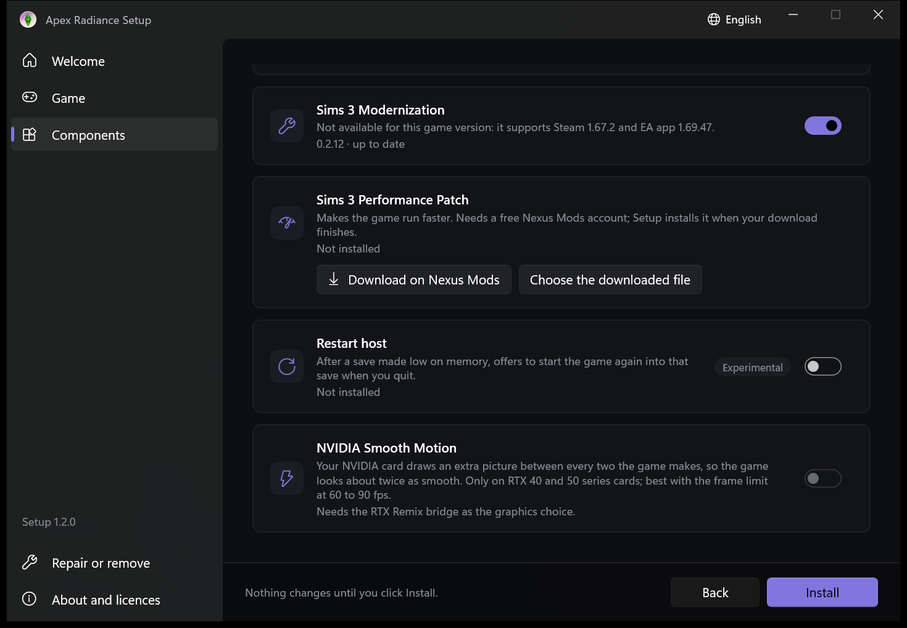
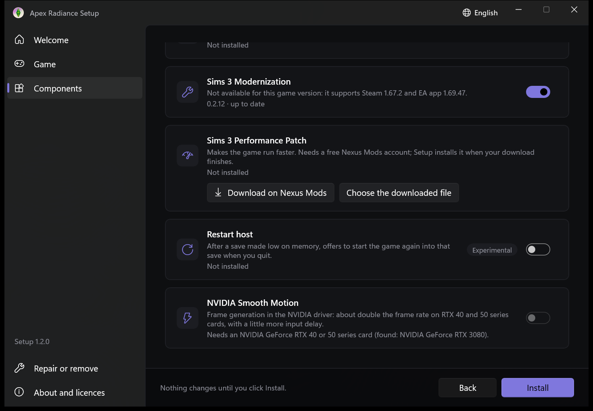
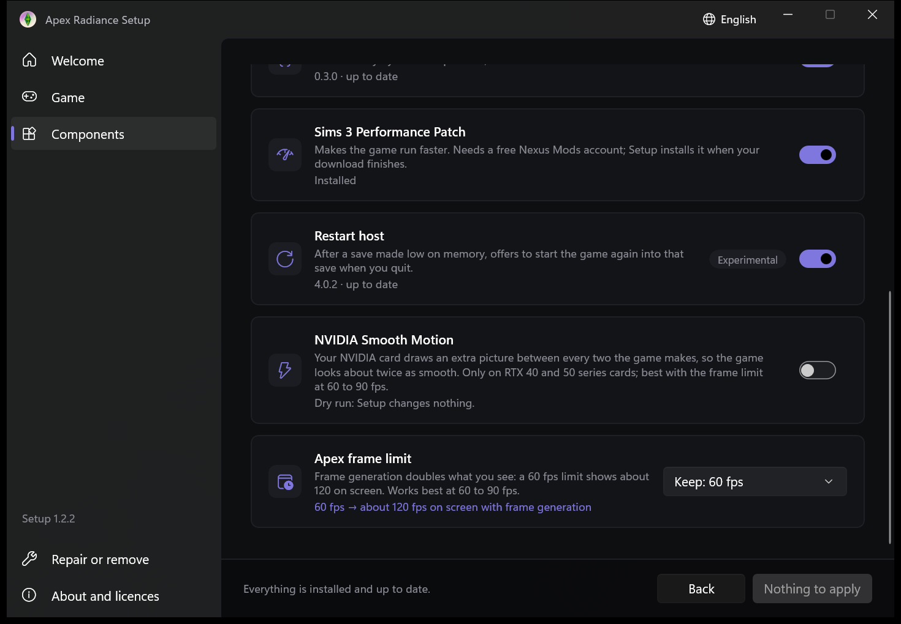
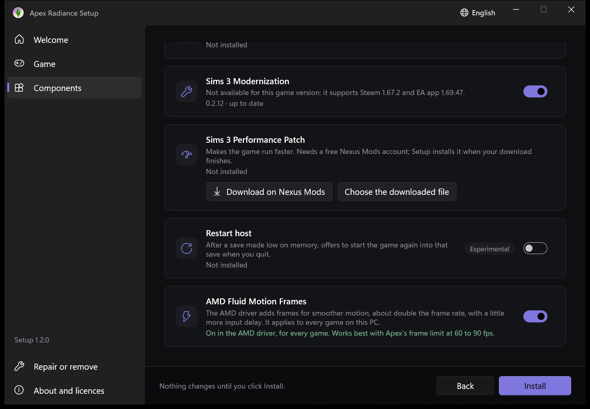
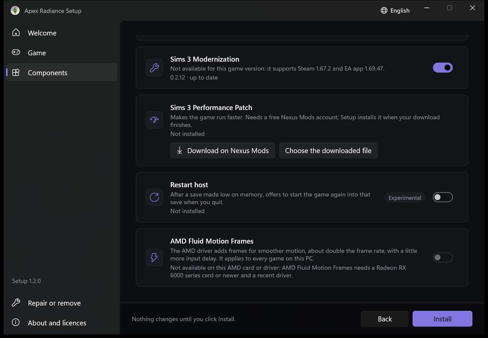

# Apex Launcher: components, install and update

The Components screen of [Apex Launcher](launcher/README.md) (Apex Radiance Setup up to 1.2.x, `ApexRadianceSetup.exe`)
installs Apex Radiance and the mods it works with into The Sims 3, keeps them up to date, checks the installation and
repairs or removes it. The player picks the game and the components; the launcher downloads each file from its author's
own release and changes only what differs from that choice. Every change can be undone from a restore point. A game
without Apex Radiance gets the same steps as one card, the first install. It is optional: the manual install in the
[README](../../README.md#installation) gives the same result.

## Status

| | |
|---|---|
| Availability | Released in 3.1.1; `ApexRadianceSetup.exe` is a release asset. Setup's own update: Released in 3.1.4 (Setup 1.1.0). Modernization from the newest release with the game's build, a moved EA app game: Released in 3.1.5 (Setup 1.1.1). Installs from the manual-install zip (the release's two files): Released in 3.1.6 (Setup 1.1.2). DXVK and the bridge offered only when the graphics driver has the extensions DXVK needs, MonoPatcher no longer offered (offered again from 4.1.1): Released in 3.2.1 (Setup 1.1.3). The restart host as an experimental component, off by default: Released in 4.0.0 (Setup 1.1.5). The RTX Remix bridge as the default renderer of a first install: Released in 4.0.1 (Setup 1.1.7). NVIDIA Smooth Motion switch: Released in 4.0.3 (Setup 1.2.0). Sims 3 Modernization's experimental channel: Unreleased. The restart host on by default in a new install, no longer experimental: Released in 4.1.0. Apex Launcher 2.0: Released in 4.1.0. Apex Launcher 2.3: Released in 4.1.1 ([Apex Launcher](launcher/README.md)) |
| Default | Optional, a separate download |
| Menu | Apex Launcher > Components (*Repair or remove* from Settings); the first-install card |
| Configuration | `Game\Bin\Apex Radiance backup\setup.json` (what is installed, the versions, Sims 3 Modernization's channel `ModernizationChannel`); restore points in `Game\Bin\Apex Radiance backup\restore`; the launcher's own files in `%LOCALAPPDATA%\Apex Launcher` ([data folders and files](launcher/data-and-files.md)) |
| Source | [`Engine.cs`](../../installer/ApexSetup.Core/Engine.cs), [`Scan.cs`](../../installer/ApexSetup.Core/Scan.cs), [`Compat.cs`](../../installer/ApexSetup.Core/Compat.cs), [`RestorePoints.cs`](../../installer/ApexSetup.Core/RestorePoints.cs), [`SmoothMotion.cs`](../../installer/ApexSetup.Core/SmoothMotion.cs), [`Afmf.cs`](../../installer/ApexSetup.Core/Afmf.cs), [`MainWindow.xaml.cs`](../../installer/ApexSetup/MainWindow.xaml.cs), [`MainWindow.Install.cs`](../../installer/ApexSetup/MainWindow.Install.cs), [`MainWindow.WizardScreens.cs`](../../installer/ApexSetup/MainWindow.WizardScreens.cs) ([installer/README.md](../../installer/README.md)) |

## The problem

A manual install needs several files from different projects placed in `Game\Bin`: the ASI loader, Apex Radiance, an
optional renderer (DXVK or the RTX Remix bridge, whose `bridge.conf` must name the game's exe) and the other mods a
player uses. Each has its own release page and its own update cycle, a wrong or duplicate file stops a mod from loading,
and a file overwritten by hand cannot be put back.

## How Apex Radiance solves it

The launcher finds the game, compares what is installed with the player's choice and applies the difference:

1. **Game.** It finds Steam 1.67.2 (`TS3W.exe`) and EA app 1.69.47 (`TS3.exe`) installs, or a folder the player picks.
2. **Components.** Apex Radiance is required. The renderer is the RTX Remix bridge (recommended, chosen by default on a first install, DXVK when the GPU check rules it out; an update keeps the installed renderer) zip of the Apex
   release, DXVK, or the game's own Direct3D 9. DXVK and the bridge are offered only when a graphics card has Vulkan 1.3 and the
   device extensions DXVK requires (`Gpu.DxvkExtensions`, from DXVK 3.1.1's required list); without them DXVK finds no adapter
   and the game closes at start. Vulkan 1.3 with an extension missing is an old driver, not an old card (an Intel Iris Xe on
   driver 101.4502 lacks `VK_KHR_load_store_op_none`, which Iris Xe drivers have from 101.6556): the launcher then asks for a driver
   update, and when DXVK or the bridge is already installed the status shows the error with the vendor's driver page; Ultimate ASI Loader is added only when no loader is found; other mods that work
   with Apex can be switched on. The [restart host](performance/restart-host.md) (*TS3Wrap* in the launcher) is a switch, on in a new install
   unless the player turns it off (off while Apex has not yet copied older S3SS settings): on installs `ts3wrap.exe` next to the ASI and sets `[ui] restart_host = true` in `ApexRadiance.toml`; off
   removes the exe and sets the key to `false` when it is there. Setup 1.1.4 and earlier copied `ts3wrap.exe` with Apex
   and left it off; an Apex update now removes that copy unless the host is on. The full list, with sources and target folders, is in
   [installer/README.md](../../installer/README.md#what-it-does).
3. **Install.** Every file is downloaded at install time from its author's GitHub release (never re-hosted) and checked
   against the release's SHA-256 digest when it has one. A file is copied only when it is missing or older than the
   latest release. Switching an installed component off removes it.
4. **Backups.** Every file the launcher replaces is moved to `Game\Bin\Apex Radiance backup` with `.bak` appended, so no
   loader reads it. `setup.json` in that folder records what the launcher installed.
5. **Compatibility fixes.** At the end of every install, or with *Fix settings* on the Components step, the launcher runs the checks of the game's
   Settings > Compatibility page before the game starts and fixes what it can (a second ASI loader or Apex copy, a
   wrong `client.targetProcess`, a missing `Resource.cfg`); the rest is reported with a link.
6. **Suggestions.** What Apex Radiance recommends in game is listed as *Suggested for Apex Radiance* on the Components
   step and on the game's status, only while `ApexRadiance.asi` is installed: turning off the game's Edge Smoothing
   when it blocks Apex effects that are on, moving a renamed second copy of `ApexRadiance.asi` aside, and the renderer
   and Sims3SettingsSetter Apex recommends. None runs with Install or Repair: each has its own *Apply* (or *Apply all
   suggestions*), and a component suggestion points to Components. Applying one keeps the Components choices not yet
   installed. The full list is in [installer/README.md](../../installer/README.md#suggestions).
7. **Restore points.** Before every change (install, update, repair, removal, a fix or a suggestion) the launcher opens a
   restore point: a copy of each file as it was before the launcher first touched it, in `Game\Bin` and in Documents, and the
   files and folders it created. Every write of `ApexSetup.Core` goes through one function, so nothing is left out, and
   a file's read-only attribute is kept. An action that changes nothing keeps no point; the newest 5 are kept. The
   *Restore points* card on *Repair or remove* lists them; *Restore* puts the files back and undoes every newer point
   too. When a change fails, its error offers *Undo these changes*.
8. **Check installation.** On a game that has Apex Radiance, Components shows what is installed and whether it is up
   to date, with *Update now* for the components that have a newer release. *Check installation* scans the game again
   and verifies the installed files and the compatibility checks. The launcher's own update is described in
   [self-update](launcher/self-update.md).
9. **Repair or remove.** *Repair* downloads and copies again everything installed. Each component can be removed on its
   own, putting back the files it replaced. *Uninstall everything* removes Apex Radiance and what the launcher installed and
   restores every replaced file; mods installed by hand and the settings in Documents stay.

**NVIDIA Smooth Motion** (Setup 1.2.0) is the last row of the Components step: frame generation in the NVIDIA driver, about
double the frame rate on RTX 40 and 50 series cards, with a little more input delay. The NVIDIA app reports the RTX Remix
bridge as not compatible; a driver profile forces it, the way NVIDIA Profile Inspector does
([rtx-remix-bridge.md](rtx-remix-bridge.md)). The switch applies at once, outside Install, through NVAPI's driver settings
(`SmoothMotion.cs`). NVIDIA ships its own profile *NvRemixBridge* holding `NvRemixBridge.exe` with Smooth Motion - Enabled
APIs (`0xB0CC0875`) at 0, which blocks it; the launcher edits the profile that holds the bridge's exe, as Profile Inspector does:
on sets `0xB0D384C0` (Smooth Motion) to 1 and `0xB0CC0875` to 7 (DX12, DX11 and Vulkan). When no profile holds the exe, the launcher
creates *Apex Radiance - The Sims 3* with it. Off restores NVIDIA's defaults of both settings (or deletes the launcher's profile),
only when the launcher turned it on, recorded in `%ProgramData%\Apex Radiance Setup\smooth-motion-on.txt`: a Smooth Motion the
player turned on with Profile Inspector shows as on and stays. The game's exes stay in NVIDIA's own *Sims 3* profile: they
do not present frames under the bridge. The profile matches exe names, so it covers every copy of the game on the PC, Steam
or EA app. The row shows only with an NVIDIA card. It can be turned on with an RTX 40 or 50 series card, driver 571.86 or
newer, and the RTX Remix bridge chosen (installed, or going in with the same Apply or first install, which make the driver
change after the files); otherwise it stays off and says why, and the first install leaves the row out. When the bridge's exe belongs to a profile
of the player's, the launcher leaves it alone and names that profile. The profile is not part of restore points (it is a driver setting, not a game file). Turned on, the launcher also brings
Apex's frame limit (`[screen] fps_limit` in the game's `ApexRadiance.toml`) to 60 fps when there is none (the key absent or
0); a limit the player chose stays as it is, and the row suggests 60 to 90 fps. That change has its own restore point
(*Turn on NVIDIA Smooth Motion*) that puts back only `fps_limit`; nothing is written before the game has made the file or
while it runs. Turning Smooth Motion off leaves the frame limit as it is.

How it follows the other actions:

| Action | Smooth Motion |
|---|---|
| Removing the RTX Remix bridge, switching from the bridge to DXVK or the game's own Direct3D 9, removing Apex Radiance, *Uninstall everything* | Turned off (the launcher's profile deleted) as part of the action, with its own task row on the Install step; an NVAPI failure is logged and shown on the row and never fails the action |
| Repair, the launcher's own update, a later run | Left as it is; the row reads the driver again (no record kept) |
| A profile deleted by the player, a driver reinstall | Reads as off |
| A profile of the player's holding an exe | Never touched by any of the above |
| Dry run, preview | Nothing written |

| Off (no bridge on this game) | On | Unsupported card |
|---|---|---|
|  |  |  |

**Apex frame limit** sits below the frame generation rows while either can be used and the game has made
`ApexRadiance.toml`: a list with *Keep* (the value now), Apex's own choices (off, 30, 60, 120, 144, 165, 240) plus 75 and 90,
the 60 to 90 ones marked recommended, and *Custom* (20 to 1000, clamped as Apex reads it). A choice writes
`[screen] fps_limit` at once, through a temporary file, in its own restore point (*Apex frame limit*) that puts back the
value before only while the file still holds the one the launcher wrote; the game must be closed, and the dry run writes nothing.

The Smooth Motion and AFMF switches and the frame limit list write nothing when clicked (Setup 1.2.3): each is a pending
change, as a component is. The row says *Turns on when you click Apply* (or off, or *Changes to 75 fps*), the footer button
counts it (*Apply 1 change*) and its note lists it (*To apply: Turn on NVIDIA Smooth Motion*); switching back to the state now
drops it. Apply runs them as task rows after the components (*Apex frame limit: 75 fps*, *Turn on NVIDIA Smooth Motion*,
*Turn off AMD Fluid Motion Frames*); a failure marks its row and shows on the component row, and the rest goes on. After a
driver write the launcher reads the setting back in a new session; a change the driver did not keep is reported, and an *on* that did
not take is undone. Errors read in plain words (the call and its code go to `%LOCALAPPDATA%\Apex Launcher\ApexLauncher.log`): missing rights
ask for administrator rights, and a rejected change points to the manual steps (*How to do it by hand*: the README's Profile
Inspector steps; for AFMF, AMD Software > Gaming > Graphics > AMD Fluid Motion Frames).

| Case | Behaviour | Checked |
|---|---|---|
| RTX 4070 Ti SUPER, driver 621.24 | Reads card, driver, NVIDIA's *NvRemixBridge* profile | On the real driver (read only) |
| A driver without the *NvRemixBridge* profile | The launcher's own profile with `NvRemixBridge.exe` | Tests |
| A driver without Profile Inspector's interface IDs | The public NVAPI IDs | Code path, not run |
| RTX 40 or 50 *Laptop GPU*; several NVIDIA GPUs | The RTX 40 or 50 one is judged, whatever the order (NVAPI lists no integrated GPU) | Tests |
| An AMD integrated GPU next to an NVIDIA card | AFMF row hidden unless ADLX reports it supported | Tests; ADLX read on a real integrated GPU |
| The driver does not keep the change | *Did not take*, an *on* undone, manual steps offered | Tests |
| No rights (`-137`, access denied) | Asks for administrator rights for the driver change | Tests |
| Driver write on RTX 40 or 50; AFMF on RX 6000 or newer | | Unverified |

Only the frame generation row that applies shows (`Engine.FrameGenRows`): a usable NVIDIA card shows Smooth Motion; AFMF
shows where ADLX reports it supported, so an AMD integrated GPU that cannot run it shows nothing; with neither usable, the
NVIDIA row explains why when an NVIDIA card is there, else the AMD row does. The frame limit row names the frame generation
shown above it and, while frame generation is on or turning on, shows in the accent colour what the player gets: "60 fps
→ about 120 fps on screen with NVIDIA Smooth Motion", or about double with no limit; with it off, the limit as it is. A
limit the player chose in the same Apply (Off included) is kept; the automatic 60 fps is not applied for AFMF on a PC
with an NVIDIA card (the game may run on that card). Failed driver or frame limit changes are listed on the Done screen
(*Some changes did not apply*).

**AMD Fluid Motion Frames** (Setup 1.2.0) is the row after it, for AMD cards: frame generation in the AMD driver, through
AMD's ADLX (`Afmf.cs`). ADLX has AFMF as one setting for the whole system, not per game, so the row says it applies to
every game on the PC. The row shows when the AMD driver answers, and can be turned on where ADLX reports AFMF supported
(AMD documents Radeon RX 6000 series or newer); it does not need the RTX Remix bridge. On also applies the frame limit rule
above. The launcher records that it turned AFMF on; removing the bridge or Apex (alone, by a renderer change or with *Uninstall
everything*) turns it off only then, never a setting the player had on. Dry run, preview and the fake write nothing.

| Off | On | Unsupported |
|---|---|---|
|  |  |  |

Both editions are covered: Steam 1.67.2 (`TS3W.exe`) and EA app 1.69.47 and 1.69.43 (`TS3.exe`). Smooth Motion's profile
holds the game's own exe, the bridge check reads `client.targetProcess = TS3.exe` on the EA app, and the frame limit goes to
the edition's Documents folder; AFMF needs nothing per edition.

When the renderer changes the graphics card the game sees, the game resets its graphics options once: the launcher says so
and keeps a copy of `Options.ini`, restored when the player goes back to the game's own Direct3D 9.

## The Components screen

Apex Radiance sits on its own card on top with its version and whether it is up to date. Under it, *Parts of Apex*
(Sims 3 Modernization, Graphics, frame generation and the frame limit, *TS3Wrap*) and the mods by other modders
(Sims3SettingsSetter, the Sims 3 Performance Patch, MonoPatcher) are rows of one height: icon, name and one line, the
state in a column of its own, and the controls on the right. Modernization's channel, the renderer (the RTX Remix bridge
first, DXVK or the Windows default) and the frame limit are menus in their rows; a choice the card or driver blocks
says why. A row that Apply changes carries a dot, and the footer lists those changes. A change to a game folder the
player cannot write to, or to a driver setting, asks for administrator rights once ([elevation](launcher/elevation.md)).

**First install and updates as one card.** With no Apex Radiance in the game, the welcome and every step after it are
one card in the middle of the window, without the sidebar: Game, Components (with the renderer), Game settings (only
when something is added; [Game settings](launcher/game-settings.md)), Install, Done. The wizard counts the expansions and
stuff packs it finds. Play with updates first lists them (*Update and play*, *Play without updating*); they run in the
same card (*Updating*) and the game starts from Home. A failed first install or update is taken back out at once and
one card says why (*Try again*, *Play anyway* for an update, *Copy details*). A game that is running, no internet or a
protected game folder are said in the card.

## Settings

Choices on the Components screen. They are pending changes until *Apply*. The launcher's own settings are on
[Settings](launcher/settings.md#settings).

| Menu label | Key | Type | Default | Range | Effect |
|---|---|---|---|---|---|
| Graphics (renderer) | Files in `Game\Bin`; `setup.json` | choice | First install: the RTX Remix bridge, DXVK when the card or driver cannot run the bridge; an update keeps the installed one | RTX Remix bridge, DXVK, Windows default (Direct3D 9), Keep my `d3d9.dll` | Which renderer the game uses |
| Sims 3 Modernization | `setup.json` `ModernizationChannel` | switch and choice | On in a first install where a build for the game exists; channel Stable | Stable, Experimental | Installs Sims 3 Modernization from that channel |
| TS3Wrap | `ts3wrap.exe`; `ApexRadiance.toml` `[ui] restart_host` | switch | On in a new install | | The [restart host](performance/restart-host.md) |
| Sims3SettingsSetter, Sims 3 Performance Patch, MonoPatcher | Files in `Game\Bin` (MonoPatcher's packages in `Mods\Packages\MonoPatcher`) | switch | Off unless installed | | Installs or removes that mod |
| Apex frame limit | `ApexRadiance.toml` `[screen] fps_limit` | choice | *Keep* | Off, 30, 60, 75, 90, 120, 144, 165, 240, Custom (20 to 1000) | Apex's frame limit, in its own restore point |
| NVIDIA Smooth Motion | NVIDIA driver profile (`0xB0D384C0`, `0xB0CC0875`) | switch | Off | | Frame generation in the NVIDIA driver, with the RTX Remix bridge |
| AMD Fluid Motion Frames | ADLX, for the whole PC | switch | Off | | Frame generation in the AMD driver |

## Compatibility and interactions

- The launcher refuses to change files while `TS3W.exe`, `TS3.exe`, the game's own launcher (`Sims3Launcher.exe`,
  `Sims3LauncherW.exe`), the restart host (`ts3wrap.exe`) or `NvRemixBridge.exe` runs.
- Sims 3 Modernization has a channel under its switch: *Stable* (default) or *Experimental*, test builds published as
  GitHub prereleases tagged `vX.Y.Z-exp.YYYYMMDD`. Experimental takes the newest of them with the game's build
  (`Engine.PickModernization`) and falls back to stable when there is none (the EA app for now); the log names the
  release and channel. The choice is kept in `setup.json`. An update within a channel keeps `ts3native.ini`; a channel
  change copies it to `ts3native.ini.<left channel>.bak` (`stable` or `experimental`, the last one kept) next to itself
  and writes the channel's own, since the switches differ between channels. When the release listing fails, the
  experimental channel shows no update and no channel change. Same-day builds (`-exp.YYYYMMDD.N`) count as newer by
  `N`. The status row shows the installed tag, with *Experimental* when it is one.
- It runs as the player and asks for administrator rights once per change when `Game\Bin` is in a protected folder
  such as Program Files ([elevation](launcher/elevation.md)); it needs an internet connection to download.
- Mods published outside GitHub are recognised and listed with a link to their official page, never downloaded. The
  Sims 3 Performance Patch is on Nexus Mods only: the launcher opens its page and installs the file when
  the download finishes.
- Apex Radiance itself does not depend on the launcher; a manual install and a launcher install are the same files.

Before any download the launcher checks what would stop the change (the game, its launcher or the restart host running, a
`Game\Bin` it cannot write to, too little free space) and tells what it will do to the player's own files (a foreign
`d3d9.dll` such as ReShade, named and set aside in the backup; a second ASI loader). A failed install puts back what it
changed unless the player keeps it. Errors read in plain words with the raw text below, *Copy details* and *Open log
folder*; the log is `%LOCALAPPDATA%\Apex Launcher\ApexLauncher.log`. The full list is in
[installer/README.md](../../installer/README.md#reliability-setup-124).

## Limitations

- Windows 10 version 1809 or later, 64-bit.
- Not yet verified on a real install: the administrator prompt on a game under Program Files, and installs on the EA
  app edition ([validation](../validation/installer.md#open-checks)).
- Ultimate ASI Loader 10 (the latest release, which the launcher installs) can open a *Select Override (Update) Folder* dialog at
  start: one player on the EA app saw it, with an empty button, before the launcher opened; 9.7.4 has no such dialog. What
  triggers it is unverified, so the launcher does not change anything for it yet.
- Without the GitHub API (60 calls an hour per address) the launcher reads the release pages instead.
- Restore points cover the files the launcher changes; files changed by hand are not tracked. Restoring is final, needs the
  game closed, and only the newest 5 points are kept.
- The Edge Smoothing suggestion reads `Options.ini` `edgesmoothing`, where Apex reads the back buffer: 0 was seen with
  no MSAA, and that every other value means MSAA is unverified in game. It changes the file only when the player clicks
  *Apply*.
- AMD Fluid Motion Frames: unverified on a supported card (no RX 6000 or newer was available); the ADLX start and the
  supported check were read on an AMD integrated GPU, which reports it unsupported. Whether AFMF reaches frames presented by
  `NvRemixBridge.exe` (Vulkan) is unverified. The record that the launcher turned it on is per Windows user, not per game folder.
- NVIDIA Smooth Motion edits NVIDIA's own *NvRemixBridge* profile and restores its defaults on off. Setup 1.2.0 wrote a
  profile of its own, which held no exe (both were in NVIDIA's profiles), so the write failed with `DRS_SetSetting -160`.
  The write on NVIDIA's profile is unverified until tested on an RTX 40 card. `0xB0D384C0` is not in the driver's list of
  named settings (621.24); Profile Inspector writes it all the same. Only a value set in the bridge's own profile counts as
  on (one inherited from the global profile does not reach the bridge, whose Enabled APIs still block it). The *How to do
  it by hand* link opens the README on GitHub's default branch, which has the Profile Inspector steps once release 4.0.3
  is merged. DXVK on `TS3W.exe` is Vulkan as well, but Smooth Motion under DXVK is untested, so the
  switch needs the bridge.

## Technical reference

- The engine (`Engine.cs`: components, install, removal, `Manifest` for `setup.json`), the scan of `Game\Bin`
  (`Scan.cs`), the installed-file check (`Verify.cs`) and the compatibility checks (`Compat.cs`) are in
  [ApexSetup.Core](../../installer/ApexSetup.Core/). Restore points are in `RestorePoints.cs`; `Fs` is the one place
  that writes.
- `Releases.cs` reads each component's GitHub releases (the API, then the release page).
- `APEX_SETUP_DRY_RUN=1` shows what the launcher finds and would change while writing nothing; the other test
  variables are listed in [data folders and files](launcher/data-and-files.md#technical-reference).
- Build and tests: [workflow.md](../workflow.md#apex-launcher); the release step is in
  [release-process.md](../release-process.md#4-build-and-publish).

## See also

- [Apex Launcher](launcher/README.md): every screen of the launcher
- [installer/README.md](../../installer/README.md): component sources, compatibility fixes, suggestions
- [Validation](../validation/installer.md): tests, results and open checks
- [README installation](../../README.md#installation): the manual install
- [RTX Remix bridge](rtx-remix-bridge.md), [Display](display.md)
